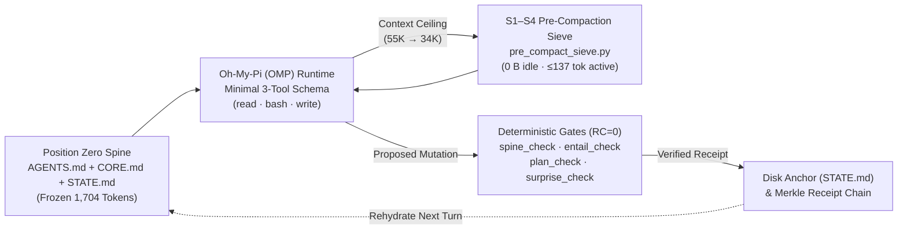

# OMP Governance Scaffold

[](LICENSE)
[](https://spoon-t8i.github.io/omp-governance-scaffold/)
[](https://spoon-t8i.github.io/omp-governance-scaffold/llms.txt)

**Deterministic control-plane governance for long-horizon local AI coding agents.**  
Instead of bloating system prompts with fragile prose rules that erode during context compaction, this scaffold separates **probabilistic token generation** (quantized local MoE models) from **deterministic verification** (standalone Python/Bash `RC=0` gates, `before_compact` lifecycle hooks, and disk-anchored state).

> **Interactive Documentation & Two-Tier Guides:** [**spoon-t8i.github.io/omp-governance-scaffold**](https://spoon-t8i.github.io/omp-governance-scaffold/)  
> **Single-Shot LLM Ingestion Bundle:** [`llms.txt`](https://spoon-t8i.github.io/omp-governance-scaffold/llms.txt) · [`llms-full.txt`](https://spoon-t8i.github.io/omp-governance-scaffold/llms-full.txt)

---

## Closed-Loop Control Architecture



---

## Empirical Receipts & Benchmark Telemetry

Measured across multi-hour autonomous engineering runs (3D WebGL2 engines, bit-exact `ffmpeg` audio editors, and hardware probes) on a tri-GPU Linux workstation (`ASUS ROG Strix X570-E`, `Ryzen 9 5900X`, `94 GiB` DDR4, dual `RTX 5060 Ti 16 GB GDDR7` in CPU-direct `x8/x8` + `Intel Arc A310` display shock absorber, `CachyOS 7.3.5-2`, `Strata v0.1.68`, `Qwen 3.8 Flash-Next NVFP4`):

| Metric | Measured Result | Architectural Mechanism |
| :--- | :--- | :--- |
| **Position-Zero Spine** | **`1,704` tokens** | Frozen `AGENTS.md` (`25` tok) + `CORE.md` (`1,033` tok) + `STATE.md` (`<=650` tok) |
| **Prefix-Cache Hit Rate** | **`98.7%` median** | Immutable Position-Zero prefix + append-only turn discipline |
| **Local Decode Throughput** | **`54 – 74.7 tok/s`** | `180B` total / `6B` active MoE (`NVFP4`) on Blackwell `sm_120` with `11/12` MTP draft acceptance |
| **Working Context Runway** | **`~43,000` tokens** | Inside a `65,536`-token ceiling with deterministic `55K -> 34K` compaction |
| **Compaction Sieve Cost** | **`0 B` idle / `<= 137` tok active** | `S1–S4` AST/regex extraction on OMP `before_compact` hook |
| **Deterministic Gate Suite** | **`584 / 584` passing checks** | Standalone Python/Bash exit-code verifiers (`spine_check.py`, `fact_store.py` `290/290`) |

---

## 10-Second Standalone Quickstart

You do not need a multi-GPU workstation to inspect or run the deterministic governance gates and compaction sieve locally (`Python 3.10+`, zero external pip dependencies):

```bash
git clone https://github.com/spoon-t8i/omp-governance-scaffold.git && cd omp-governance-scaffold
python3 src/hooks/pre_compact_sieve.py --help
python3 src/gates/spine_check.py --help
```

---

## Repository Map & Two-Tier Documentation

Every guide on the [GitHub Pages site](https://spoon-t8i.github.io/omp-governance-scaffold/) opens with **Tier 1 (Plain-English Intuition)** followed immediately by **Tier 2 (Systems Engineering & Control-Theoretic Specification)**:

| Path | Description |
| :--- | :--- |
| [`src/spine/`](src/spine/) | Frozen Position-Zero constitution (`AGENTS.md`, `CORE.md`, `STATE.template.md`, `surprise_policy.json`). |
| [`src/hooks/`](src/hooks/) | `S1–S4` Pre-Compaction Sieve (`pre_compact_sieve.py`) hooked into OMP's `before_compact` lifecycle event. |
| [`src/gates/`](src/gates/) | 10 standalone `RC=0` verification gates (`spine_check.py`, `entail_check.py`, `plan_check.py`, `fact_store.py`, `regime_sensor.py`, `surprise_check.py`, `merkle_compactor.py`, `gate_exec.py`, `gate_freeze.py`, `checkpoint.sh`). |
| [`src/tools/`](src/tools/) | Line-bounded surgical editor (`edit_file.py`), static impact analyzer, token probe, and session telemetry utilities. |
| [`docs/`](docs/) | Jekyll GitHub Pages source (`architecture`, `compaction-sieve`, `attractors`, `workstation`, `projects`, `theory`, `influences`, `llms.txt`, `llms-full.txt`). |
| [`AGENTS.md`](AGENTS.md) | Root repository navigation contract for autonomous CLI coding agents. |

---

## License

Published under the [Apache License, Version 2.0](LICENSE). See [NOTICE](NOTICE) for attribution details.
