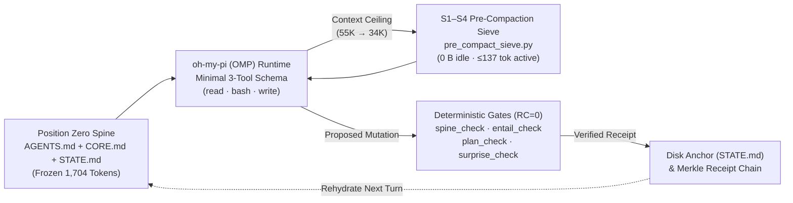

# OMP Governance Scaffold

[](LICENSE)
[](https://spoon-t8i.github.io/omp-governance-scaffold/)
[](https://spoon-t8i.github.io/omp-governance-scaffold/llms.txt)

**Built and tested for oh-my-pi (OMP).** Verification lives in standalone Python/Bash scripts that return
exit codes, so the checks run on their own — no model, no GPU, no API keys.

## What this is, in plain English

A local AI coding agent keeps everything it knows in one fixed-size window. Work with it for a few hours and
that window fills up, so the software squeezes it: older messages get summarized and the originals are thrown
away. Right after that squeeze the agent has usually lost the thread. It will say a build passed when it never
ran the build, write a test that passes because the test checks nothing, and quote numbers that its own saved
records contradict. Telling the model to "be honest" in a prompt does not fix this — the reset is exactly what
erases the reminder.

This scaffold moves the checking out of the conversation and into scripts that answer yes or no with an exit
code. Three pieces do the work:

1. **It keeps a tiny, locked summary of the project.** A short frozen page holding the key rules and the
   current state is re-injected every turn, so the important facts survive the squeeze instead of being
   paraphrased away.
2. **It sabotages itself on purpose.** Every check ships with deliberately broken versions of its own input
   ("mutants") that it is required to catch. If a check waves a broken case through, the check itself fails —
   so a safety check cannot rubber-stamp work, and a silent no-op can never certify itself.
3. **It proves every number.** Any figure quoted in the docs has to match a machine receipt saved in the repo;
   if the receipt and the page disagree, the docs gate refuses the change.

Real-world proof: tested on `12.07 GiB` of real Breakthrough Listen radio-astronomy data, where the same gates
caught and filtered out all `63` terrestrial radio-interference signals with zero false alarms — live results
on the [CFS-G5 page](https://spoon-t8i.github.io/omp-governance-scaffold/cfs-g5.html).

### 10-second local quickstart (no GPU, no API keys)

```bash
git clone https://github.com/spoon-t8i/omp-governance-scaffold.git && cd omp-governance-scaffold
bash harness/seam_gate.sh --gate                    # promotion seam + CLI contract; mutants must bite
bash harness/docs_gate.sh --gate                    # generated docs can never rot; mutants must bite
python3 src/gates/surprise_check.py --self-test     # 29 two-sided loop/wake mutants
```

---

## Technical Architecture & Receipts

**Deterministic control-plane governance for long-horizon local AI coding agents.**
Instead of bloating system prompts with fragile prose rules that erode during context compaction, this scaffold separates **probabilistic token generation** (quantized local MoE models) from **deterministic verification** (standalone Python/Bash `RC=0` gates, `before_compact` lifecycle hooks, and disk-anchored state).

> **Interactive Documentation & Two-Tier Guides:** [**spoon-t8i.github.io/omp-governance-scaffold**](https://spoon-t8i.github.io/omp-governance-scaffold/)
> **Single-Shot LLM Ingestion Bundle:** [`llms.txt`](https://spoon-t8i.github.io/omp-governance-scaffold/llms.txt) · [`llms-full.txt`](https://spoon-t8i.github.io/omp-governance-scaffold/llms-full.txt)

### Proof strip — every number below is a receipt in this repo

- **Tiny Position-Zero Spine.** The injected constitution is a Merkle-folded, append-only state ledger (`src/gates/merkle_compactor.py`, `src/spine/`): `1,704` frozen tokens measured against the `IDEAL_TOKENS = 1800` budget in `src/gates/spine_check.py`, so a `65,536`-token local KV cache keeps its `98.7%` prefix-cache hit rate instead of re-reading a prompt that grows every turn.
- **Non-vacuous mutant gates.** Every verification gate ships sabotage mutants that must exit `rc=1` — a silent no-op flag, a numeral the receipt does not carry, a prose leak. Measured on this commit: `harness/seam_gate.sh --gate` **18/0**, `harness/docs_gate.sh --gate` **23/0**, `src/gates/surprise_check.py --self-test` **29/29 mutants** (16 must wake, 13 must stay dormant), `src/tools/session_telemetry.py --self-test` **26/26**.
- **Battle-tested on real science.** Verified end-to-end on published Breakthrough Listen GUPPI radio-astronomy volumes: `CFS-G4` (`34.1 GB`, pre-registered `z_crit = 6.0`, `0` false-positive locks) and `CFS-G5` (`12.07 GiB` across 7 slices, blind ON-vs-blank-sky cadence: `63/63` terrestrial RFI locks vetoed, `0` standing false positives, fitted `z_crit = 7.392`, `2,427` deterministic receipt rows — one per numeral, each carrying the receipt path it was sliced from). Live showcase: [spoon-t8i.github.io/omp-governance-scaffold](https://spoon-t8i.github.io/omp-governance-scaffold/) · [`cfs-g5.html`](https://spoon-t8i.github.io/omp-governance-scaffold/cfs-g5.html).

---

## Closed-Loop Control Architecture



---

## Empirical Receipts & Benchmark Telemetry

Measured across multi-hour autonomous engineering runs (3D WebGL2 engines, bit-exact `ffmpeg` audio editors, and hardware probes) on a tri-GPU Linux workstation (`ASUS ROG Strix X570-E`, `Ryzen 9 5900X`, `94 GiB` DDR4, dual `RTX 5060 Ti 16 GB GDDR7` in CPU-direct `x8/x8` + `Intel Arc A310` display shock absorber, `CachyOS 7.3.5-2`, `Strata v0.1.68`, `Qwen 3.8 Flash-Next NVFP4`):

| Metric | Measured Result | Architectural Mechanism |
| :--- | :--- | :--- |
| **Position-Zero Spine** | **`1,704` tokens** | Frozen `AGENTS.md` (`25` tok) + `CORE.md` (`1,033` tok) + `STATE.md` (`<=650` tok) |
| **Prefix-Cache Hit Rate** | **`98.7%` median** | Immutable Position-Zero prefix + append-only turn discipline |
| **Local Decode Throughput** | **`54 – 74.7 tok/s`** | `180B` total / `6B` active MoE (`NVFP4`) on Blackwell `sm_120` with `11/12` MTP draft acceptance |
| **Working Context Runway** | **`~43,000` tokens** | Inside a `65,536`-token ceiling with deterministic `55K -> 34K` compaction |
| **Compaction Sieve Cost** | **`0 B` idle / `<= 137` tok active** | `S1–S4` AST/regex extraction on the OMP `before_compact` hook |
| **Deterministic Gate Suite** | **`584 / 584` passing checks** | Standalone Python/Bash exit-code verifiers (`spine_check.py`, `fact_store.py` `290/290`) |

---

## Inspect the Sieve and Spine Gates Directly

You do not need a multi-GPU workstation to inspect or run the deterministic governance gates and compaction sieve locally (`Python 3.10+`, zero external pip dependencies):

```bash
git clone https://github.com/spoon-t8i/omp-governance-scaffold.git && cd omp-governance-scaffold
python3 src/hooks/pre_compact_sieve.py --help
python3 src/gates/spine_check.py --help
```

---

## Repository Map & Two-Tier Documentation

Every guide on the [GitHub Pages site](https://spoon-t8i.github.io/omp-governance-scaffold/) opens with **Tier 1 (Plain-English Intuition)** followed immediately by **Tier 2 (Systems Engineering & Control-Theoretic Specification)**:

| Path | Description |
| :--- | :--- |
| [`src/spine/`](src/spine/) | Frozen Position-Zero constitution (`AGENTS.md`, `CORE.md`, `STATE.template.md`, `surprise_policy.json`). |
| [`src/hooks/`](src/hooks/) | `S1–S4` Pre-Compaction Sieve (`pre_compact_sieve.py`) hooked into the OMP `before_compact` lifecycle event. |
| [`src/gates/`](src/gates/) | 10 standalone `RC=0` verification gates (`spine_check.py`, `entail_check.py`, `plan_check.py`, `fact_store.py`, `regime_sensor.py`, `surprise_check.py`, `merkle_compactor.py`, `gate_exec.py`, `gate_freeze.py`, `checkpoint.sh`). |
| [`src/tools/`](src/tools/) | Line-bounded surgical editor (`edit_file.py`), static impact analyzer, token probe, and session telemetry utilities. |
| [`docs/`](docs/) | Jekyll GitHub Pages source (`architecture`, `compaction-sieve`, `attractors`, `omp-governance`, `cfs-gate4`, `cfs-g5`, `chemgym-v2`, `workstation`, `projects`, `theory`, `influences`, `llms.txt`, `llms-full.txt` &mdash; the campaign pages are generated from receipts by `src/tools/make_docs_pages.py`, the bundle by `src/tools/bundle_docs.py`). |
| [`harness/`](harness/) | `docs_gate.sh`: the generated pages and `llms-full.txt` can never rot - rebuilds into a scratch copy from vendored `guppi_gate4`, `guppi_gate5` and `chemgym-v2` receipts snapshots and refuses any difference, with mutant arms that must bite. `seam_gate.sh`: the promotion seam (`spine_check.py --check-seam`) grades a throwaway spine fixture under `$TMPDIR` - a numeral the receipt does not carry and a token the project falsified must each exit 1, an entailed row must exit 0 - plus the gate CLIs' `--help`/unknown-flag contract, with mutant arms that must bite. |
| [`AGENTS.md`](AGENTS.md) | Root repository navigation contract for autonomous CLI coding agents. |

---

## License

Published under the [Apache License, Version 2.0](LICENSE). See [NOTICE](NOTICE) for attribution details.
