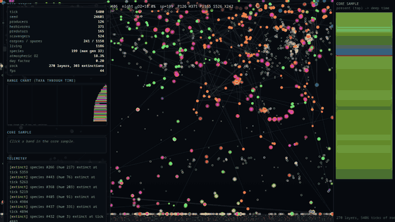
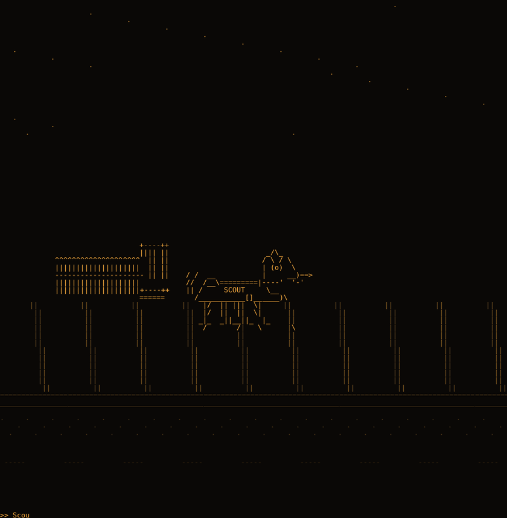

[← Back to Home](index.html)

# Projects Showcase: Three Months of Receipt-Verified Builds

## Tier 1: The High-Level Picture (Plain-English Intuition)

Theory only matters if it survives real-world stress tests. Instead of testing this governance system on toy puzzles, we put it through multi-hour engineering marathons—building playable 3D browser games, surgical audio editors, and custom hardware benchmarks from scratch—to prove the AI can work for hours without breaking its own code or inventing fake test results.

---

## Tier 2: Systems Engineering & Closed-Loop Empirical Validation

Each project below serves as an adversarial, multi-hour integration harness measuring **working runway stability (`~43k` tokens)**, **prefix-cache hit rates (`98.7%`)**, and **external oracle parity** (`ffmpeg` bit-exact `max|d| = 0`, automated WebGL2/Canvas2D visual audits, and `584/584` deterministic gate checks) under sustained autonomous execution.

---


*Licensed under the Apache License, Version 2.0. See `LICENSE` and `NOTICE` in the repository root.*

Between August and November 2026, we stress-tested the **Oh-My-Pi (OMP)** governance scaffold across seven software and systems engineering campaigns on a local Linux workstation (`Strata 0.1.68` + `Qwen 3.8 Flash-Next NVFP4`, `584/584` combined harness checks).

---

## 1. Saturn Jukebox (Multi-Console ROM Audio Appliance — Nov 2026)

* **Verification:** `157 PASS / 0 FAIL` in `25.0s` · `max|d| = 0` vs. `ffmpeg` · `0 bytes` written to read-only ROM mounts
* **PlayStation 1 CD-ROM XA & `EBOOT.PBP`:** Built an 18-Sound-Group demultiplexer with automatic rate and channel detection, matching `ffmpeg` across **39.9 million audio samples**.
* **3DO Opera Filesystem & `SDX2` / `ADP4` Audio:** Added a fast Sector-0 geometry probe and cycle-safe directory walker, unlocking **74 3DO soundtracks (11,103 tracks)** with 100% byte parity.
* **PlayStation 2 `.VAG` & `.PSS` Stream Repair:** Isolated and fixed seven stacked decoder bugs, restoring **6,936 `.VAG` tracks** across 13.28 million samples.
* **Raw 2,352-Byte Sector Scatter-Gather (`iso_gather`):** Stripped 304-byte CD error-correction headers between 2,048-byte audio frames, unlocking **26 hidden raw-sector games** across a **1,098-album / 8,488-disc** library.

---

## 2. AMBER_ASCII AT-Stream v2 & WebGL2 Fractal Audits (Oct – Nov 2026)

* **60 Hz Terminal 3D Raymarching (`AMBER_ASCII`):** Rendered monochrome and phosphor-palette 3D scenes at **40–60+ FPS** with sub-3ms input latency (`20/20` plan gates, `84/0` renderer checks, `97/0` receipt bindings).
* **WebGL2 / Mandelbulb / Strange Attractor GPU Verification:** Audited a 4,246-line zero-dependency WebGL2/Canvas2D generative engine (`30` modules including `mandelbrot`, `julia`, `newton`, `mandelbulb`, and `clifford`/`lorenz` attractors) running at **139 FPS** on our discrete Intel Arc A310 display GPU without touching compute VRAM.

---

## 3. CEIS & Secular Drift Crucible (Control-Plane Benchmarks — Nov 2026)

* **5-Family Out-of-Distribution (`W1–W5`) Benchmark:** Proved across 2,000 paired seeds per world family that partitioned 3-clock controllers (`210` weights) outperform flat single-clock controllers (`2,036` weights) across droughts, predator swarms, mazes, and reward-hazard conflicts (`+64.61` to `+84.34` survival ticks).
* **Secular Drift Compaction Benchmark:** Tested 240 campaigns across 25 repeated memory resets (`24,000` transitions), proving **receipted cryptographic epoch chains** achieve `0.0%` silent drift and `0.0%` false-alarm gridlock.

---

## 4. Cold-Boot KV-Wipe Benchmarks (Aug – Sep 2026)

* **SandGame Cellular Automata Simulator:** Orchestrated a **6-hour autonomous build** (`G0–G8` gates) yielding a zero-leak physics simulator running at **0.04 ms/step** against a `20.0 ms` frame budget.
* **Mandelbrot & Julia Set Explorer:** Wiped the model's entire active memory after building the Mandelbrot viewer, cold-booted from `.omp/STATE.md`, and added an interactive Julia Set toggle verified by cross-orbit math assertions (`24/24` checks, zero regressions).
* **Digital Spaceport Arcade Suite:** Built a multi-file web arcade (Landing Page, Asteroids, Pong, Snake) across isolated cold-boot phases (`130+` cumulative logic and browser QA assertions).

---

<!-- BEGIN GENERATED: gate4-entry -->
## 5. CFS Gate 4 &mdash; Chromatic Coherent Dedispersion on Real GUPPI Pulsar Bytes (Nov 2026)

*Full receipt page: [cfs-gate4.html](cfs-gate4.html). One session, 5 gates, 10 gate-arm receipts, `34.1 GB` of published GUPPI bytes.*

* **Pre-registered bar, never moved:** streaming multi-rotation coherent dedispersion plus narrow-plane chromatic phase folding over a 128-block span (11.9683 rotations) reached `R_plane` z = **`4.7862`** against a pre-registered `z_crit = 6.0` &mdash; a deficit of `1.2138`; the matched blank-sky sweep peaked at `4.2942` with `0` false-positive locks.
* **Null counterparties at matched depth:** the blank-sky slice swept `41` dispersion trials and the ON slice was phase-randomised into `16` spin-desynchronised surrogates &mdash; **`0` false-positive locks** on both legs, the strongest surrogate reaching `4.3335`.
* **Per-rotation stratification:** `11` audited rotations, deepest `z = 3.8493`, every one inside the Gumbel ceiling `3.4369` &plusmn; `0.3624` for its own bin count (Gumbel `p = 0.2743`, Rayleigh `p = 0.1607`).
* **Single-plane RFI immunity:** a `200`-SNR tone for `2.0 ms` per rotation is worth `2,679,610` sigma in total intensity and `-0.0013` z in the chromatic statistic.
* **Positive control, not a broken pipeline:** an injected weak coherent beacon is invisible at the `16`-block Gate 3 prefix depth (`z = 5.1629`) and a hard lock at `64` blocks (`z = 13.8325`), recovered at its injected DM `11.0`.
* **Governance under load:** `10` gate-arm receipts with every mutant arm exiting `1`; the `4,096 MiB` RSS ceiling measured per engine leg (max `3,612.9 MiB`) after one honest breach that was fixed and re-gated (pre-fix leg `4,141.3 MiB`).
<!-- END GENERATED: gate4-entry -->

<!-- BEGIN GENERATED: chemgym-entry -->
* [ChemGym-v2: Physics-Benched Chemistry Environments](chemgym-v2.md) - 5 gym-style chemistry benches with library-read physics, SARSA dominant on 5/5 benches, 158/158 physics checks and 23/23 mutant controls caught.
<!-- END GENERATED: chemgym-entry -->

---

## Showcase 1: Strata v17 — Taphonomic Deep-Time Biosphere & De-Extinction Engine

*Synthesized in ~1 hour from multiple prior local-AI life-simulator iterations into a single-file zero-allocation Web/Canvas2D engine (`1,592` lines, `75,977 B`) built and verified under the OMP governance harness (`~148 ticks/s` / `~144 fps` sustained on the Intel Arc A310 visual QA pipeline).*



### Tier 1: The High-Level Picture (Plain-English Intuition)

Most artificial-life simulations only care about the creatures swimming around on screen right now. **Strata v17** is really about **the mud at the bottom**.

As four guilds of organisms (producers, herbivores, predators, and scavengers) evolve, form colonies, and die in a deep-water column, their remains sink into a scrolling rock core on the right side of the screen. Just like real paleontology, the rock record is **systematically biased**: when oxygen is high and scavengers are hungry, dead organisms get eaten before they can fossilize—meaning a thriving, well-oxygenated ocean actually leaves behind a *poorer* fossil record than a stagnant, low-oxygen one. You can click any ancient rock layer, inspect its preserved DNA, and **resurrect extinct species** back into a modern ecosystem they never evolved in.

---

### Tier 2: Systems Engineering, SoA Memory Layout & Taphonomic Invariants

#### 1. Zero-Allocation Data-Oriented Runtime
* **Structure-of-Arrays (`Float32Array`):** The entire biosphere (`MAX_CELLS = 2,600` slots, `free-list deadPool`) lives inside a contiguous `Float32Array(2600 * 48)` with zero heap object allocations inside the `120 Hz` fixed-timestep hot loop (`MAX_TICKS_PER_FRAME = 8`, `IGNITE` 900-tick headless warm-up).
* **Spatial & Environmental Grids:** `34 px` spatial hash buckets (`GRID_SIZE`) pair with a `6 px` 6-lane water column (`light` with standing-crop self-shading, slow chemostat `food`, `O2` relaxation + bloom overshoot, `waste`/`pheromone` 4-neighbour diffusion, 4-frequency travelling `temp`/`pH` waves, and a `3%` EMA global atmosphere).
* **Behaviour as Genome:** Steering is not hardcoded state machines—16 heritable genes plus 8 signed chemotaxis/neighbour sensory weights (`w:food`, `waste`, `pher`, `pred`, `prey`, `corp`, `O2`, `light`) drive force integration (`damp = 0.86`), colony damage dilution (`computeClusterSizes`, up to 5 bonded nodes), and `v17.1` asymmetric pursuit (`speedCap = 1.5 * (0.70 + 0.45 * spd)` for predators vs. `1.5` global cap for prey, calibrated across `4 seeds * 4,206 ticks * 11 settings`).

#### 2. The Taphonomic Preservation Filter & Portable Rock Core
Every `120 / layersPerSec` ticks, `closeLayer` commits a time-slice bed (`MAX_LAYERS = 360`, oldest beds fused via tick-weighted compaction `compactOldest`) containing trophic census, climate/atmosphere means, extinction stamps, anomaly markers (asteroid, ice age, anoxia, mass extinction), and up to `8` reservoir-sampled fossil genomes gated by the taphonomic preservation equation:

```text
pres = clamp01(0.10 + 0.55 * (1 - O2) - 0.30 * min(3, scavengerDensity))
```

* **Closed-Loop De-Extinction (`inspectLayer` / `resurrect(k, f)`):** Extracts a fossil genome vector from any historical bed and spawns an asexual-capable founder (`>215` fission threshold) into the live water column (`DE-EXTINCTED sp#N ... X ticks dead -> new sp#M`).
* **Portable Core Serialization (`exportCore` / `importCore`):** Serializes `{v:'strata-17', seed, tick, atmoO2, layers, extinctions[-400:]}` to Base64 so stratigraphic cores can be archived, diffed, and re-imported across sessions.

#### 3. Measured Telemetry & Honest Model Boundaries
* **Measured Performance (`45 s` wall-clock run):** `6,694` ticks (`~148 ticks/s`, `~144 fps`), `436` living cells (`159` herbivores, `61` predators, `190` scavengers, `108` corpses), `102` species across `27` generations, `19.3%` atmospheric `O2`, and `335` stratigraphic beds (`328` extinctions).
* **Explicit Scope Limits:** Arbitrary non-SI units; drag (`0.86`) substitutes for Navier-Stokes fluid viscosity; temperature and `pH` act as niche-mismatch cost penalties rather than Arrhenius metabolic kinetics; `aggr` remains a drift-only latent gene (`2` write occurrences, `0` reads); and the `8`-fossil reservoir sample is intentionally lossy by design.
---

## Showcase 2: Chromatic Frequency States — Cross-Regime DSP & Optical Dispersion Synthesis

*A `5 h 32 min` two-regime investigative synthesis (`6` DAG nodes, `6/6 PROVEN`, `27` archived gate logs) that produced a `55,474 B` zero-dependency probe, a `214,271 B` machine-readable receipt file and a `30,421 B` report in which every numeral is machine-bound: `51/51` claims ENTAILED, `0` CONTRADICTED, `738/738` numerals covered (`100.0 %`), with `entail_check.py`, `plan_check.py` and `spine_check.py` all at `RC=0`.*

### Tier 1: The High-Level Picture (Plain-English Intuition)

Pitch and colour are the same circle read from opposite ends. Music folds frequency onto a twelve-slot ring by throwing octaves away (`log2(f/f0) mod 1` on `S^1`); a waveguide does the reverse, unwrapping frequency into a delay each colour accumulates (`beta(omega)`, `v_g = (d beta/d omega)^-1`, `GVD = d^2 beta/d omega^2`). Both therefore fail in the same place — energy that belongs in one bin, one pitch class, or one time slot bleeds into its neighbours — and both recover through the same class of estimator: discard amplitude, trust phase. Rather than assert that symmetry in prose, the build measured it: the octave-fold residual, the group-delay tilt and the attractor basins of both regimes come out of one executable probe, and the harness — not the narrative — decided which claims survived.

#### 1. Why the Verification Had to Be Mechanical
* **No hand-typed numbers:** the report is *generated* from the receipt file, so a transcription error is structurally impossible; `39` checks (`all_pass = true`) run in `25.835 s` under pinned seed `20261125` and pinned probe hash `2a050940…`.
* **Two-sided gates:** every node carries a positive gate and an inverted negative control; all six passed at exit `0` and all six negatives failed at exit `1`, so a green DAG means the gate can actually go red.

### Tier 2: Systems Engineering, Empirical Receipts & Governance Catch

#### 1. Zero-Transcription-Drift Pipeline
* **Generate, then re-derive:** `make_report.py` renders `REPORT.md` straight from `receipts.json`; `tools/verify_report.py` re-parses the finished prose and re-derives each figure from the JSON, and `tools/check_receipts.py` gates each regime section (`regime_a`, `regime_b`, `cross`) independently — three sections, three failing negative controls.
* **Numeric entailment as the closure gate:** `entail_check.py REPORT.md --receipts receipts.json --root .` binds every numeral in the report to a JSON path: `51` claims over `16` artifacts, `51` ENTAILED, `0` CONTRADICTED, `0` UNBOUND, coverage `738/738` (`100.0 %`).

#### 2. Verified Headline Metrics (`receipts.json`)

| Metric | Measured | What it pins |
|---|---|---|
| Gaussian propagation vs. closed form | `3.331e-16` max rel. error | the split-step engine is exact, so regime differences are physics and not numerics |
| Chirped-Gaussian oracle | `2.757e-07` max rel. error | linear chirp accumulation matches the analytic `C1/C2` solution |
| `beta3` retrieval from `beta2(D)` | `0.02530` rel. error | third-order dispersion is recoverable from measured GVD curves |
| Soliton `N=1` after `4` dispersion lengths | width ratio `1`, energy rel. err `9.58e-13` | isospectral: the phase-locked state neither broadens nor radiates |
| Soliton `N=2` breath period | `1.4044 km` vs. `1.40514 km` (`0.000507` rel. err) | breath period and the `N^2 = 4` recombination peak (measured `3.9994`) |
| Normal-regime pulse (`N=1`, `0.8 um`) | width `4.0479` vs. linear `4.1231` | no soliton exists above the zero-dispersion wavelength |
| Clock tone at the worst span (`8 km` @ `0.8 um`, `xi_o = 11.572`) | `0.852949 -> 0.245596 -> 0.852949`, ISI `0.0007273 -> 1.7424 -> 0.0007273` | full second-order compensation returns the train to its input state |
| Pitch estimate: STFT bin-max vs. phase-derivative IF | `21.488` cents vs. `0.001789` cents (ratio `12012`) | sub-cent pitch at `N = 512` comes from phase coherence, not a longer window |
| Octave-fold residual, `rect` mainlobe `6` bins | `0.2893` pitch classes | the leakage basin: energy crosses more than one pitch class |
| Leakage crosstalk, worst pair | `36.238 dB` | the floor under any 12-bin chroma estimate |

#### 3. The `tail -2` → `stale=5` Sieve Intercept
* **The trap:** the frontier was checked with `plan_check.py … --frontier | tail -2`. Two lines of output looked green while `5` of the `6` closed nodes were `STALE` — their gate freezes were pinned to pre-closure commits (`546689a`, `8160999`), and the closure commit moved `HEAD` off all of them at once.
* **The fix:** re-run every gate at the new `HEAD` (`7a38f73`) and checkpoint the spine plus the project (`356e03f`), never edit the freeze text — `STATE.md` pins the rule verbatim: *"a stale freeze is a repin, never a prose edit."* Post-fix: `plan_check.py --read-only` reports `6/6` done at `RC=0`, `spine_check.py` reports `0` violations, and the pre-compaction sieve reports `dirty = 0`.
* **The general lesson:** truncating a gate's output to make it readable converts a status gate into a decoration. The gate is the exit code plus the full node list; anything piped through `tail` is a summary of a claim, not the claim.

#### 4. Data-Driven Calibration Boundaries
* **Octave-width ratio, not its ideal value:** the `C3/C6` kernel-width ratio carries a `-3.057805e-06` grid-quantisation offset that is *identical* across all `9` window x `N` combinations (spread `8.88e-16`), so the gate is on the offset's invariance at `1e-4` — demanding the ratio equal `8` to `1e-6` tests the FFT grid, not the physics.
* **Constant-Q honesty:** the constant-Q transform is not scored by driving `cv_bins_per_class` to zero (it measures `0.0744323`); the defensible claim is that it beats every fixed-`N` grid (`0.181752`–`0.213176`) by `2.44x` to `2.86x`.
* **Compensation direction:** `clock_compensated` is *not* better than `clock_out` — full compensation restores the input, so the falsifiable pair is "returns to the input value" plus "the longest span degrades below half the input clock", exact to `1e-9`.
* **Window-family separation is an order of magnitude, not a threshold:** leave-one-out chroma residual is `< 0.05` for every smooth window (worst `0.01166`) and `0.04518`–`0.2893` for `rect`, a `3.874x` separation between the best `rect` row and the worst smooth row, `24.8x` worst-against-worst — an earlier draft of the state ledger claimed `15x` from a single row and was corrected against the receipt file.
---

## Showcase 3: Dog Town v3 — Real-Time Two-Lane ASCII Cinema

*A `40.0 FPS` terminal cinema in which a locally hosted sparse MoE directs the show while it runs: `DOG3-01..04` proven under a receipt-backed DAG harness, and every numeral below is machine-bound to one `20.0 s` live-LLM receipt (`rec3.json`: `800` frames, `3` prompts, `1` operator preemption).*



### Tier 1: The High-Level Picture (Plain-English Intuition)

A show that waits four seconds for the model is a slideshow, not a show. Dog Town v3 therefore runs direction on two clocks at once:

* **The local lane** reads the keystroke in the frame it arrives. `cut to the neon alley, heavy rain, tension 4` is resolved by keyword rules and applied on the spot — `0.13`, `2.77`, `4.83 ms` for the three prompts of the receipt run, all inside one `25 ms` frame — so the stage visibly reacts before the model emits a single token.
* **The director lane** asks the local MoE for a structured register (scene, palette, weather, camera, tension, marquee, narration, cast, sprite) and applies it field-by-field as the stream closes each field, so narration is already typing and speaking while the tail of the register is still decoding.

The second lane is where the instructive failure lived. Local decode is CPU-hungry: while the engine streamed cold MoE experts, decode saturated the box's CPU quota and the frame-timing gates began failing on a show that was rendering perfectly. The finding is not *the renderer is slow* but **a timing gate run against a busy box measures the box, not the show.** Two repairs followed: a cadence-gated paired A/B leg that flips one HUD strip inside a single content timeline and rejects any pair that loses its `25 ms` cadence, and a quiet-box yield rule that parks LLM decode while a timing-sensitive gate executes.

---

### Tier 2: Lane Contract, Verified Receipts & Honest Boundaries

#### 1. Lane Contract and Backpressure
* **Grammar-ordered streaming:** the response grammar is ordered by latency tier (stage cues, then narration payload, then cast/sprite payload) so a cue can be applied the moment its field closes instead of at end-of-response.
* **Register accounting:** `3` lane calls, `3` registers closed, `3` flushed, `0` short, `0` cut, `0` deadline hits, `1` cancelled by operator preemption (`t = 9.0 s`, `voice_dropped = 0`).
* **Preemption, not queueing:** prompts were submitted at `t = 2.0`, `9.0`, `15.5 s` (`6.5`–`7.0 s` apart), above the `~4.0`–`5.5 s` cadence floor at which a new ask cancels an in-flight register; the runner documents why — with four requests queued, measured first byte went from `2.9 s` to `24.7 s`.

#### 2. Verified Headline Metrics (`rec3.json`)

| Metric | Measured | What it pins |
|---|---|---|
| Frames emitted / late / freezes | `800 / 0 / 0` at `40.0 FPS` over `20.0 s` | the render loop never dropped or froze a frame while the director lane was decoding |
| Frame time p50 / p99 / max | `0.01 / 0.02 / 22.71 ms` | steady-state cost is hundredths of a millisecond; the max is a single hiccup, see §4 |
| Hotkey dispatch max (gate `<= 10.0 ms`) | `0.039 ms` | keyboard handling clears its gate by more than two orders of magnitude |
| Local keyword cue, `3` prompts | `0.13 / 2.77 / 4.83 ms` | the local lane answers inside the frame the key arrives |
| Remote first byte | `1957.89 / 2457.80 ms` | live local MoE decode latency on a loaded box |
| First remote cue on screen (TTFC) | `2045.73 / 2599.85 ms` | the remote stage cue lands mid-parse, not at completion |
| First narration | `2570.77 / 3124.86 ms` | typing and speech begin before the register closes |
| Full parse | `4482.86 / 3711.51 ms` | TTFC precedes completion by `1.43x` to `2.19x` |
| Voice lane | `2` of `2` spoken, `0` dropped, `0` underruns, `0` transport failures, max backlog `5.211 ms` | narration never starved or double-spoke under preemption |
| Bounded story state | `39` words / `916` bytes across `2` beats | continuity is a rolling block, not a growing transcript |
| Live-generated sprite | `STRAY_DOG`, `2` frames, `5` rows x `7` cols | an LLM-authored sprite that cleared the bounding-box sanitizer before caching |
| Sprite patrol | `10` samples over `4.65 s`, column `124 -> 64`, frame parity alternating every sample | the 2-frame cycle really animates while the sprite walks |
| Scene cuts | `3` | Bayer crossfades between distinct backdrops, driven by the director lane |

#### 3. Continuity as a Measured Object
* **Beat handoff:** the story block carried into the next beat is `STORY scene=ROOFTOP_RAIN weather=CLEAR tension=2 arc=SETUP` plus `CAST STRAY_DOG:PATROL` — the dog the operator asked for in beat one is still on screen, and still patrolling, in beat two.
* **Bounded by construction:** `2` beats cost `916` bytes of log and `39` words of prompt injection, so a multi-hour show cannot grow its own context the way a raw console dump would.

#### 4. Honest Boundaries
* **The `22.71 ms` max is not a hotkey cost:** `hotkey_paint_ms_max` equals `frame_ms_max` exactly, i.e. one scheduling hiccup on a box at load average `11.56`, while dispatch itself peaked at `0.039 ms`.
* **The voice lane ran on a null sink:** `real_device = false`, `device_busy_s = 7.2`, so the `2` of `2` spoken and `0` underruns are pipeline accounting, not an acoustic claim.
* **One receipt, three prompts:** every figure above is a single `20.0 s` run (`2` narration turns, `1` preemption); the cadence floor and the `2.9 s` to `24.7 s` queue-collapse figure come from the runner's own measured comment, not from this receipt.
